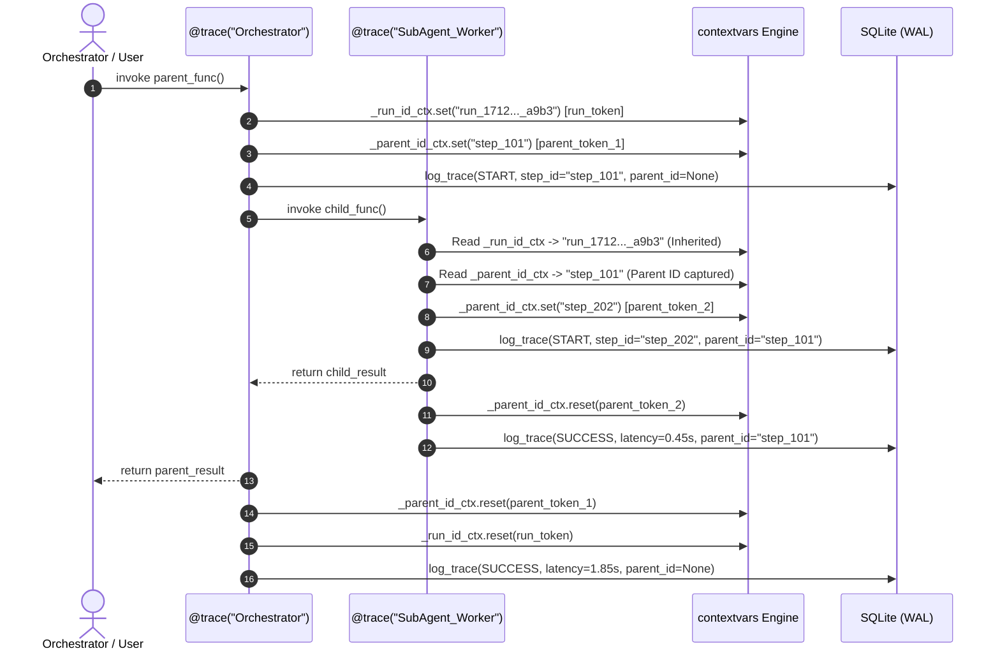

# Comprehensive System Architecture & Deep Technical Review
## AgentLens (`agentlens-ui`)
**Author / Principal Reviewer**: Senior Staff Software Engineer & Distributed Systems Observability Architect  
**Target Audience**: Senior/Staff Engineers, Infrastructure Architects, Technical Hiring Committees  
**Codebase Location**: `E:\agentlens\AgentLens\agentlens_project`  
**Distribution**: PyPI (`agentlens-ui` v0.1.0)  

---

## Executive Summary

**AgentLens** is a zero-dependency, local-first observability and execution tracing engine architected specifically for multi-agent autonomous frameworks (such as CrewAI, LangGraph, AutoGen, and custom async LLM pipelines). 

Unlike cloud-heavy observability platforms (e.g., LangSmith, Arize Phoenix, Datadog LLM Observability) that mandate remote API keys, complex sidecars, or high-latency telemetry transports, AgentLens implements an ultra-lean, embedded architecture:
1. **Low-Overhead Telemetry Fabric**: Synchronous and asynchronous function decorators (`@trace`) leveraging Python 3.7+ `contextvars` for thread-safe and coroutine-safe call-graph lineage.
2. **Crash-Resilient Embedded Store**: Local SQLite database operating in **Write-Ahead Logging (WAL)** mode with explicit busy timeouts, deferred lazy initialization, and connection pooling hygiene via `contextlib.closing`.
3. **Zero-Crash Serialization Barrier**: Dynamic object sanitization intercepting non-serializable objects (generators, Pydantic models, binary blobs) before telemetry writes.
4. **Self-Contained Full-Stack Visualizer**: An embedded FastAPI backend serving a lightweight, zero-npm vanilla JS/CSS forensic dashboard with real-time polling, waterfall timelines, flame-graph latency metrics, and JSON payload inspection.

---

## 1. High-Level System Architecture & Component Topology

```mermaid
graph TD
    subgraph Agent_Process["Client Multi-Agent Application Process (e.g., CrewAI, LangGraph)"]
        Dec["@trace('agent_name') Decorator"]
        LogFn["log_trace(...) Programmatic Hook"]
        CtxVar["contextvars (_run_id_ctx, _parent_id_ctx)"]
        Sanitizer["_safe_serialize() JSON Boundary"]
        SQLiteConn["get_db_connection() (sqlite3 + WAL)"]
    end

    subgraph Storage_Layer["Local Storage Boundary (Host OS)"]
        DBFile["agentlens.db (SQLite Database)"]
        WALFile["agentlens.db-wal (Write-Ahead Log)"]
        SHMFile["agentlens.db-shm (Shared Memory Index)"]
    end

    subgraph Server_Process["Observability Server Process (CLI: agentlens ui)"]
        CLI["agentlens_ui.cli (argparse)"]
        Uvicorn["Uvicorn ASGI Server (:8000)"]
        FastAPIApp["agentlens_ui.server:app"]
        DBRead["get_db() with sqlite3.Row Factory"]
        StaticFS["index.html (Packaged Asset)"]
    end

    subgraph Browser_Client["Developer Browser (Frontend Dashboard)"]
        UI["http://localhost:8000"]
        Poller["Live Polling Engine (setInterval 1.5s)"]
        Waterfall["Waterfall Call-Tree / Flamegraph"]
        Inspector["JSON Tree & Forensic Inspector"]
    end

    %% Telemetry Write Path
    Dec -->|Intercept Enter/Exit/Raise| CtxVar
    Dec --> Sanitizer
    LogFn --> Sanitizer
    Sanitizer --> SQLiteConn
    SQLiteConn -->|Atomic INSERT INTO traces| DBFile
    DBFile --- WALFile
    DBFile --- SHMFile

    %% Server Read Path
    CLI --> Uvicorn
    Uvicorn --> FastAPIApp
    FastAPIApp -->|Serve HTML| StaticFS
    FastAPIApp -->|Read API /api/runs, /api/traces| DBRead
    DBRead -->|Concurrent Lockless Read| DBFile

    %% Frontend Interaction
    StaticFS --> UI
    UI --> Poller
    Poller -->|Fetch /api/traces/{run_id}| FastAPIApp
    Poller --> Waterfall
    Waterfall --> Inspector
```

---

## 2. Telemetry Engine & Context Lineage Mechanics

The primary instrumentation surface is defined in [`src/agentlens_ui/core.py`](./src/agentlens_ui/core.py).

### Asynchronous & Synchronous Context Tracking (`contextvars`)
Autonomous multi-agent architectures (such as CrewAI's concurrent execution or LangGraph's state graph branches) execute tasks across mixed synchronous worker threads and asynchronous coroutine event loops. Standard thread-local storage (`threading.local`) fails catastrophically in async runtimes because coroutines interleave across the same OS thread.

AgentLens solves this using Python native `contextvars.ContextVar`:

```python
_run_id_ctx: ContextVar[str] = ContextVar("run_id", default="system")
_parent_id_ctx: ContextVar[Optional[str]] = ContextVar("parent_id", default=None)
```



#### Detailed Mechanical Analysis:
1. **Dynamic Execution Inspection**:
   Using `inspect.iscoroutinefunction(func)`, the `@trace` decorator dynamically branches into either an `async_wrapper` or `sync_wrapper`, preserving zero coroutine overhead for synchronous tools while guaranteeing native `await` chaining for async agents.
2. **Context Scope Isolation & Token Cleanup**:
   Every invocation stores token instances (`run_token`, `parent_token`). Inside an unconditional `finally` block:
   ```python
   finally:
       _parent_id_ctx.reset(parent_token)
       if run_token:
           _run_id_ctx.reset(run_token)
   ```
   This guarantees that even when an agent crashes with an unhandled exception (`ZeroDivisionError`, LLM API rate limit `429`, prompt timeout), the execution context resets cleanly to its parent state, preventing cross-tenant context pollution across long-running worker pools.

---

## 3. Storage Layer & Concurrency Architecture

### SQLite in Write-Ahead Logging (WAL) Mode
A common antipattern in local telemetry systems is database locking under concurrent write operations (`sqlite3.OperationalError: database is locked`). AgentLens resolves this through 4 explicit structural decisions:

```python
def get_db_connection() -> sqlite3.Connection:
    conn = sqlite3.connect(DB_PATH, timeout=10.0)
    conn.execute("PRAGMA journal_mode=WAL")
    return conn
```

1. **WAL Journaling (`PRAGMA journal_mode=WAL`)**:
   Standard SQLite rolls changes into an atomic rollback journal, enforcing an exclusive lock where readers block writers and writers block readers. In WAL mode, writes append sequentially to `agentlens.db-wal` while readers read from shared memory (`agentlens.db-shm`). **Readers and writers operate concurrently without blocking.**
2. **Explicit Busy Timeout (`timeout=10.0`)**:
   If a write transaction is currently committing, subsequent connections wait up to 10 seconds before raising an operational exception, smoothing burst writes during parallel agent operations.
3. **Explicit Connection Disposal via `contextlib.closing`**:
   SQLite connections in Python do not automatically close when leaving scope if references linger. AgentLens enforces deterministic descriptor releases via `with closing(get_db_connection()) as conn:` wrapped in a transactional context manager `with conn:`.
4. **Lazy Database Schema Initialization**:
   ```python
   def ensure_db_initialized() -> None:
       global _db_initialized
       if _db_initialized:
           return
       ...
   ```
   Importing `from agentlens_ui.core import trace` has **zero side effects**. It does not access the filesystem or create empty `.db` files until the first telemetry event is written.

### Database Schema Design
```sql
CREATE TABLE IF NOT EXISTS traces (
    id TEXT PRIMARY KEY,          -- UUID v4 hex (Telemetry Step ID)
    run_id TEXT,                  -- Session / Orchestration Run ID
    agent_name TEXT,              -- Logical Agent / Tool Name
    step_type TEXT,               -- START | SUCCESS | ERROR | THOUGHT | TOOL
    content TEXT,                 -- Human-readable message or step summary
    details TEXT,                 -- Serialized JSON object (Parameters, outputs)
    latency REAL,                 -- Millisecond / Floating second execution duration
    parent_id TEXT,               -- Causal dependency (Enables Tree reconstruction)
    timestamp REAL                -- Unix epoch timestamp (High precision)
);

CREATE INDEX IF NOT EXISTS idx_run_id ON traces(run_id);
```
- **Indexing Strategy**: An explicit B-Tree index on `run_id` ensures that fetching the trace sequence for a specific multi-agent run (`SELECT * FROM traces WHERE run_id = ? ORDER BY timestamp ASC`) executes in $O(\log N + K)$ time rather than triggering a table scan across historical traces.

---

## 4. Bulletproof Serialization Boundary

In modern agent frameworks (CrewAI, LangChain, AutoGen), tool outputs and agent thoughts are frequently returned as complex objects:
- Pydantic models (`BaseModel` instances with custom fields)
- Lazy iterators / Generators
- Unserializable binary blobs or circular object references

Calling naive `json.dumps(details)` crashes the application runtime. AgentLens establishes a resilient serialization boundary:

```python
def _safe_serialize(obj: Any) -> Any:
    if isinstance(obj, (str, int, float, bool)) or obj is None:
        return obj
    try:
        json.dumps(obj)
        return obj
    except (TypeError, ValueError):
        return str(obj)
```

In `log_trace`:
```python
try:
    clean_details = {k: _safe_serialize(v) for k, v in (details or {}).items()}
    details_json = json.dumps(clean_details, default=str)
except Exception:
    details_json = json.dumps({"_serialization_error": "Payload contained un-serializable binary or complex objects."})
```

- **Two-Tier Fallback Defense**:
  1. Primitive types pass untouched.
  2. Non-primitives are tested against `json.dumps`. If serialization fails, the object falls back to its string representation (`str(obj)`).
  3. If dictionary transformation fails entirely, a fallback serialization error payload is recorded, guaranteeing that **telemetry failures never crash production agent workloads**.

---

## 5. Web Server Architecture & Frontend Forensic Engine

### Embedded Server Architecture
The visualization layer is exposed via FastAPI and served through Uvicorn:
- Command: `agentlens ui`
- Entrypoint: [`src/agentlens_ui/cli.py`](./src/agentlens_ui/cli.py) -> [`src/agentlens_ui/server.py`](./src/agentlens_ui/server.py)
- Configuration: Bound strictly to `127.0.0.1:8000` (`reload=False`, `log_level="warning"`).

#### REST API Contracts:
- `GET /api/runs`: Returns distinct execution run identifiers ordered by latest timestamp.
  ```json
  [
    {"run_id": "run_1712390123_f9c2a"},
    {"run_id": "run_1712389410_d3e1b"}
  ]
  ```
- `GET /api/traces/{run_id}`: Returns all recorded lifecycle steps for the specified run in chronological sequence.
- `GET /`: Serves the single-page application dashboard ([`src/agentlens_ui/index.html`](./src/agentlens_ui/index.html)).

### Frontend Architecture: Zero-Dependency Forensic Dashboard
[`src/agentlens_ui/index.html`](./src/agentlens_ui/index.html) is an embedded single-file application (359 lines of raw HTML5, CSS Grid, and vanilla ES6 JavaScript) bundled directly into the Python wheel.

```
+---------------------------------------------------------------------------------------+
|  👁️ AGENTLENS  |  Run: [ run_1712390123_f9c2a v ]  |  Filter: [Search...]  | [● Live] |
+-----------------------------------------------------------+---------------------------+
|  WATERFALL TRACE TIMELINE (48% width)                     | FORENSIC INSPECTOR (52%)  |
|                                                           |                           |
|  TIME      TYPE     CONTENT                   LATENCY     |  METADATA:                |
|  ---------------------------------------------------------+  Step ID: 3a9e1f...       |
|  02:30:12  START    Crew_Execution                --      |  Parent ID: None          |
|  02:30:13  START    Web_Search_Tool               --      |  Agent: Web_Search_Tool   |
|  02:30:14  SUCCESS  Web_Search_Tool            1.502s     |  Latency: 1.502s          |
|  02:30:15  THOUGHT  Agent completed a reason      --      |                           |
|  02:30:16  SUCCESS  Crew_Execution             3.841s     |  PAYLOAD (JSON Tree):     |
|                                                           |  {                        |
|                                                           |    "result": "Found..."   |
|                                                           |  }                        |
+-----------------------------------------------------------+---------------------------+
```

#### Frontend Technical Highlights:
1. **Live Delta Polling**:
   Uses an active `setInterval` polling loop (every 1,500ms). It tracks trace count and prevents redundant DOM repaints if the trace array length and content have not mutated.
2. **Interactive Search & Filtering**:
   Real-time regex and substring matching over agent names, step types (`START`, `SUCCESS`, `ERROR`, `THOUGHT`), and content payloads.
3. **Causal Hierarchy Visualization**:
   Matches `parent_id` against previous `id` records to establish nesting relationships, visually differentiating top-level agent orchestrations from sub-tool invocations.
4. **Syntax-Highlighted JSON Inspector**:
   Parses `details` payloads into interactive, formatted JSON objects with color-coded tokens for numeric, boolean, string, and null types.

---

## 6. Comprehensive Failure Modes & Resilience Matrix

| Failure Mode | Root Trigger | Code Location | System Handling & Recovery | User Visibility / Impact |
| :--- | :--- | :--- | :--- | :--- |
| **Database File Lock** | Concurrent agents write simultaneously | `core.py:get_db_connection` | WAL mode allows concurrent readers/writers; `timeout=10.0` queues competing writes. | Transparent retry within 10s window; no lock exceptions under normal loads. |
| **Corrupted / Unserializable Payload** | Tool returns circular reference or raw socket | `core.py:_safe_serialize` & `log_trace` | Nested `try-except` falls back to `str(obj)`, then to `{"_serialization_error": ...}`. | Workload never crashes. Dashboard displays serialization warning in JSON inspector. |
| **Agent Exception / Crash** | Sub-agent throws unhandled Python exception | `core.py:trace` (wrapper) | Exception intercepted; logs `step_type="ERROR"` with error string and latency; re-raises exception. | UI highlights row in bold red (`--color-error`); agent traceback preserved for developer. |
| **Context Leak Across Tasks** | Task completes or errors out mid-run | `core.py:trace` (`finally` block) | `_parent_id_ctx.reset(parent_token)` unconditionally resets ContextVar token. | Subsequent agent calls in same thread/coroutine start with clean context. |
| **Missing Wheel Asset** | Package installed without `index.html` | `server.py:serve_ui` | Checks `if not html_path.exists(): raise HTTPException(404)`. | Returns HTTP 404 with message `"UI artifact missing from wheel."` |
| **Uninitialized Database Read** | UI opened before any agent has executed | `server.py:get_runs` & `get_traces` | Catches `sqlite3.OperationalError` (missing table) and returns empty array `[]`. | Dashboard displays clean empty state without crashing or throwing 500 errors. |

---

## 7. Build, Packaging, & PyPI Distribution Specification

The project follows modern Python packaging specifications as defined in [`pyproject.toml`](./pyproject.toml):

```toml
[build-system]
requires = ["setuptools>=61.0"]
build-backend = "setuptools.build_meta"

[project]
name = "agentlens-ui"
version = "0.1.0"
description = "Zero-config, local observability UI for multi-agent systems."
readme = "README.md"
requires-python = ">=3.9"
dependencies = [
    "fastapi>=0.100.0",
    "uvicorn>=0.23.0",
]

[project.scripts]
agentlens = "agentlens_ui.cli:main"

[tool.setuptools.package-data]
agentlens_ui = ["*.html"]
```

### Build & Distribution Highlights:
1. **Minimal Runtime Dependency Tree**:
   Only 2 external dependencies (`fastapi`, `uvicorn`). Does not pull in heavyweight analytical frameworks (pandas, numpy, polars) or bloated telemetry SDKs (OpenTelemetry, grpcio).
2. **Global CLI Entry Point**:
   Registers the `agentlens` executable via `project.scripts`, allowing developers to launch the UI directly from any project terminal (`agentlens ui`).
3. **Asset Inclusion Guarantee**:
   Declares `agentlens_ui = ["*.html"]` in `tool.setuptools.package-data`. This ensures `index.html` is packaged inside `.whl` and `sdist` distributions, preventing runtime 404 errors when installed via `pip install agentlens-ui`.

---

## 8. Staff Engineer Comparative Analysis & Production Roadmap

### Architectural Comparison

| Dimension | AgentLens (`agentlens-ui`) | LangSmith / Phoenix / WandB | OpenTelemetry Collector |
| :--- | :--- | :--- | :--- |
| **Deployment Footprint** | Zero configuration; embedded SQLite | Cloud SaaS / Complex Docker Compose | External Collector daemon + Jaeger/Zipkin |
| **External Network Overhead** | Exactly 0 ms (100% localhost) | 50ms - 250ms per telemetry batch | 5ms - 20ms over gRPC/OTLP |
| **API Key / Secret Requirement** | None | Required (Cloud API Tokens) | None / Mutual TLS |
| **Dependency Weight** | Lightweight (`fastapi`, `uvicorn`) | Heavy (LangChain SDK, PyDantic, gRPC) | Heavy (OTel SDK, Protobufs) |
| **Multi-Agent Tree Resolution** | Automatic via Python `contextvars` | Manual run tree metadata wiring | Manual traceparent propagation |

### Production Roadmap & Next-Level Enhancements

1. **Streaming Token & LLM Cost Analytics**:
   Extend `traces` table schema to capture `prompt_tokens`, `completion_tokens`, and `model_name`. Implement client-side aggregation in `index.html` to display total cumulative financial cost per run.
2. **OpenTelemetry (OTel) Exporter Bridge**:
   Provide an optional exporter module (`agentlens_ui.otel`) allowing developers to export SQLite traces to enterprise OTel endpoints (Datadog, Honeycomb) when graduating from local prototyping to cloud staging.
3. **Automated Pruning & TTL Policies**:
   Add a maintenance background task or CLI command (`agentlens clean --days 7`) to prevent `agentlens.db` from growing unbounded across thousands of execution runs.
4. **WebSocket / Server-Sent Events (SSE) Push**:
   Replace the frontend 1.5s HTTP polling loop with an SSE endpoint (`GET /api/stream/{run_id}`) utilizing FastAPI’s `EventSourceResponse`, achieving sub-millisecond telemetry UI updates.
